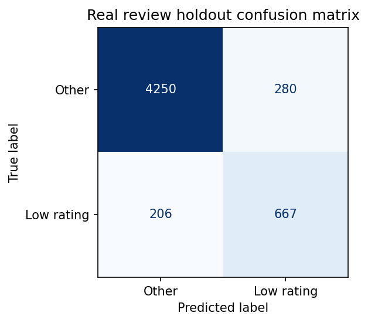
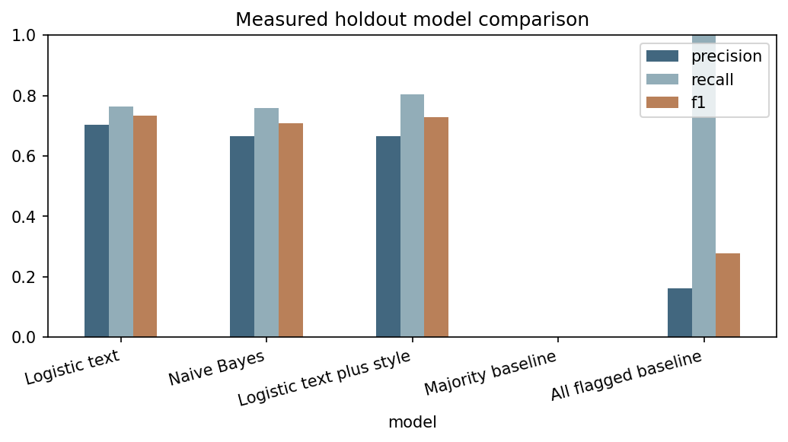

# Beauty Review Intelligence

**M Nithish Kumar — Yuvaintern Data Science with Python**

## Current project status

Weeks 2–6 were rebuilt on **real public Amazon Review Data 2018 All Beauty**
on 30 October 2026. This version supersedes the initial synthetic demonstration.
The already submitted Week 1 report remains an unchanged historical problem
definition. Its synthetic scope describes that earlier stage, not the current
experiment. Earlier code and data remain recoverable in Git history.

The current analysis downloads the complete public review archive and product
metadata, takes a uniform 30,000-row reservoir sample with seed 42, and retains
27,609 reviews across 8,365 products after documented quality checks. It uses
review bodies to classify the rating proxy: 1–2 stars versus 3–5 stars.

This predicts a label from feedback already received. When a star rating is
available, use a direct rating filter. Transfer to unrated feedback requires
new independently labelled validation.

## Actual results

| Quantity | Measured result |
|---|---:|
| Full public review archive | 371,345 reviews |
| Uniform sample before cleaning | 30,000 |
| Metadata coverage exclusions | 441 |
| Empty body exclusions | 31 |
| Repeated normalized body exclusions | 1,919 |
| Clean reviews | 27,609 |
| Train / validation / test reviews | 16,691 / 5,515 / 5,403 |
| Selected model | Logistic regression with TF IDF |
| Threshold chosen on validation | 0.575 |
| Test precision | 0.7043 |
| Test recall | 0.7640 |
| Test F1 | 0.7330 |
| Test average precision | 0.7865 |
| Test ROC AUC | 0.9462 |
| True positive / false positive | 667 / 280 |
| False negative / true negative | 206 / 4,250 |

Parameter selection uses training-only three-fold product-group CV AP. Model
selection uses validation AP; threshold selection uses validation F1. Test
results are evaluated after freezing those choices. The extra style features
did not improve validation AP, so the simpler text model was retained.




## Open the evidence

| Weekly task | Report | Main supporting files |
|---|---|---|
| Week 1 — historical definition | [Word report](reports/Week_01_Problem_Definition.docx) | Original conceptual stage; retained as submitted |
| Week 2 — real sourcing | [Word report](reports/Week_02_Data_Sourcing.docx) | [Source manifest](data/source_manifest.json), [sample profile](outputs/source_sample_profile.csv) |
| Week 3 — executed cleaning | [Word report](reports/Week_03_Data_Cleaning.docx) | [Audit](outputs/cleaning_audit.json), [flowchart](outputs/cleaning_flow.png), [verifier result](outputs/verification.json) |
| Week 4 — EDA and features | [Word report](reports/Week_04_EDA_Features.docx) | [EDA summary](outputs/eda_summary.json), [theme counts](outputs/theme_mentions.csv), [ablation evidence](outputs/validation_metrics.csv) |
| Week 5 — modeling | [Word report](reports/Week_05_Modeling.docx) | [CV settings](outputs/cross_validation.csv), [validation metrics](outputs/validation_metrics.csv), [test metrics](outputs/model_metrics.csv) |
| Week 6 — evaluation | [Word report](reports/Week_06_Evaluation_Impact.docx) | [Full result summary](outputs/summary.json), [error references](outputs/error_cases.csv), [PR curve](outputs/precision_recall.png) |

[Submission descriptions for Weeks 2–6](reports/Submission_Descriptions.txt)
are also available in [Word](reports/Submission_Descriptions.docx).

## Reproduce on a Windows laptop

Tested using Python 3.12.14. Python 3.12 is recommended for exact environment
reproduction. Internet is needed once to install packages and download the
approximately 46.7 MB review archive and 10.3 MB metadata archive.

1. Download the repository ZIP with **Code > Download ZIP** and extract it.
2. Open VS Code. Select **File > Open Folder** and choose the extracted folder.
3. Select **Terminal > New Terminal**. Enter these commands one at a time:

```powershell
py -3.12 -m venv .venv
.venv\Scripts\python.exe -m pip install -r requirements-lock.txt
.venv\Scripts\python.exe src\run_project.py
.venv\Scripts\python.exe src\validate_project.py
```

The program downloads sources to ignored `data/raw/`, validates their SHA 256
checksums, samples, cleans, analyzes, trains and evaluates. No API key or paid
service is needed. Runtime depends on the laptop; the recorded run took about
48 seconds after local source access. Your source acquisition timestamp and
runtime will differ. Avoid running from inside the `src` folder if using the
relative commands above.

If you already downloaded the source archives, use:

```powershell
.venv\Scripts\python.exe src\run_project.py --source "C:\path\All_Beauty.json.gz" --metadata "C:\path\meta_All_Beauty.json.gz"
```

If `py -3.12` is unavailable, install Python 3.12 from its official vendor
distribution and reopen VS Code. This is an environment prerequisite, not a
project API key issue.

## Source and provenance

- [Publisher documentation](https://nijianmo.github.io/amazon/index.html)
- [Exact review archive](https://mcauleylab.ucsd.edu/public_datasets/data/amazon_v2/categoryFiles/All_Beauty.json.gz)
- [Exact metadata archive](https://mcauleylab.ucsd.edu/public_datasets/data/amazon_v2/metaFiles2/meta_All_Beauty.json.gz)
- [Associated paper by Ni, Li and McAuley, EMNLP-IJCNLP 2019](https://aclanthology.org/D19-1018/)

The downloaded review dates range from 10 January 2000 to 2 October 2018.
This is not the 2023 release or a current market snapshot. Actual source
counts are computed from these files and can differ from metadata totals
listed on a documentation page.

No broad redistribution license is asserted. Raw source archives, copied
review bodies, titles, reviewer names and reviewer IDs are not committed.
The included compressed CSVs contain numeric or structural evidence only.
Use the publisher sources and check the applicable terms for your own use.
There is no live Amazon scraping.

`source_row` is a one-based line reference into the checksummed review archive.
Use it to recover examples locally. Text hashes allow duplicate and partition
checks without republishing bodies. Author IDs are used privately only to
count reviewer overlap and are never exported.

## Data quality and evaluation boundaries

The original category contains at least one inspected unrelated book review.
A nonempty metadata-title match is required, which removes this example with
other unmatched records. It is a coverage rule, not a complete semantic
taxonomy. Metadata category arrays were empty; subcategory findings are not
invented.

Duplicate bodies are normalized and hashed, then the earliest source row is
retained independent of label. Nineteen text groups have conflicting binary
labels before deduplication. No difficult conflicting group is entirely
deleted based on its outcome. Long reviews remain in the analysis.

Products and exact text hashes are disjoint across partitions. Author overlap
is measured in the summary; this is an unseen-product evaluation, not a claim
of unseen authors or future time periods. Near duplicate paraphrases can
remain. Bootstrap intervals resample held-out products and condition on the
frozen model. Ranking scores are not assumed to be calibrated probabilities.

Historical platform sampling, review participation bias, rating/sentiment
disagreement, shared authors and source contamination limit generalization.
Theme regex matches are mentions, not validated complaints. No causal effect,
clinical claim, live deployment, financial gain or guaranteed grade is claimed.

## Verify the saved files

`src/validate_project.py` independently recomputes metrics and checks the
cleaning equation, valid label mapping, product and exact text separation,
test membership and the validation model selection. See
`outputs/verification.json`. `evidence_checksums.json` records deliverable
file hashes for this revision.

## Submit

Follow [SUBMISSION_GUIDE.md](SUBMISSION_GUIDE.md). Upload the matching Word
report, paste its matching 200+ word description, and use this repository's
homepage URL in each remaining weekly task. No portal submissions are made
by this repository update.
